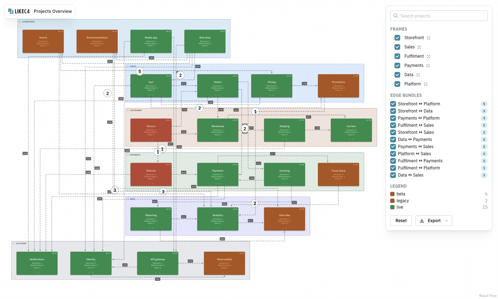
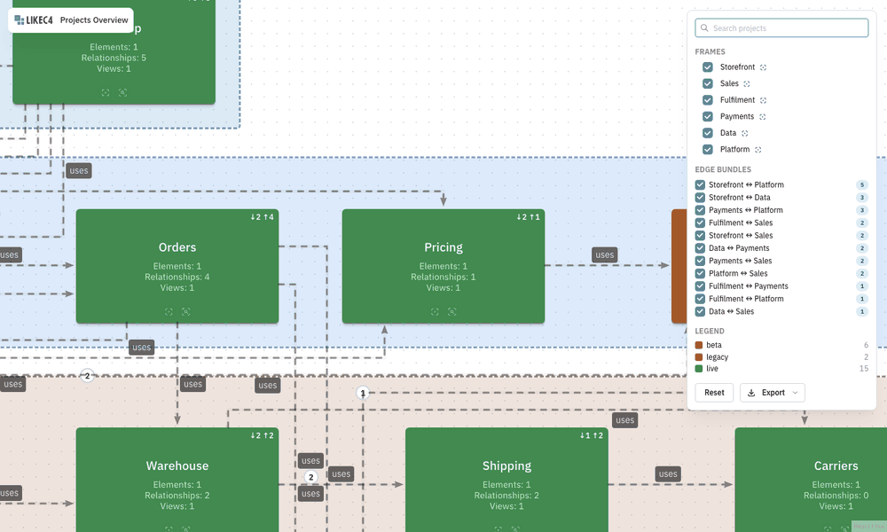
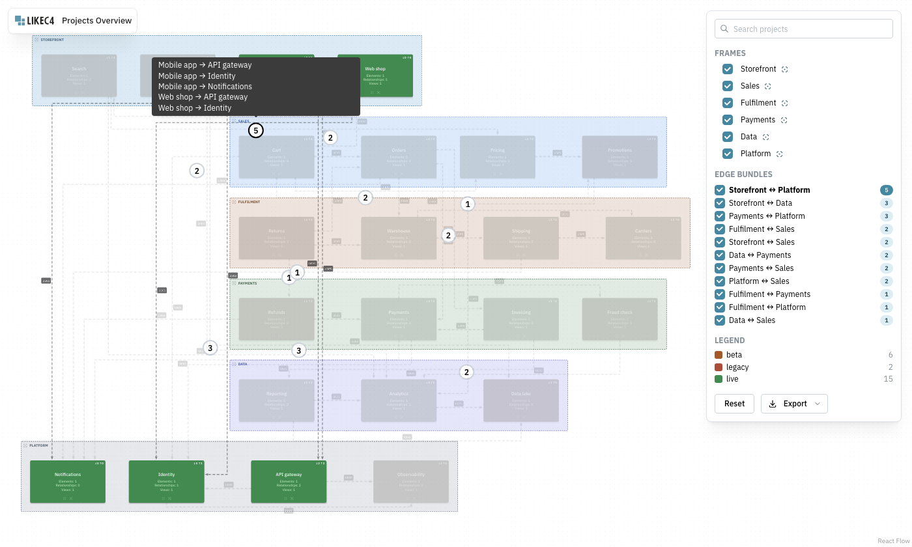
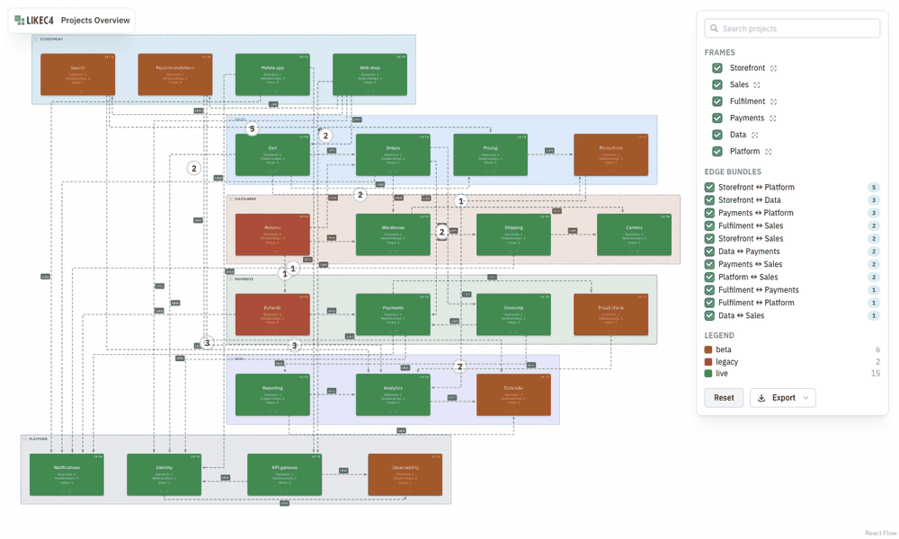
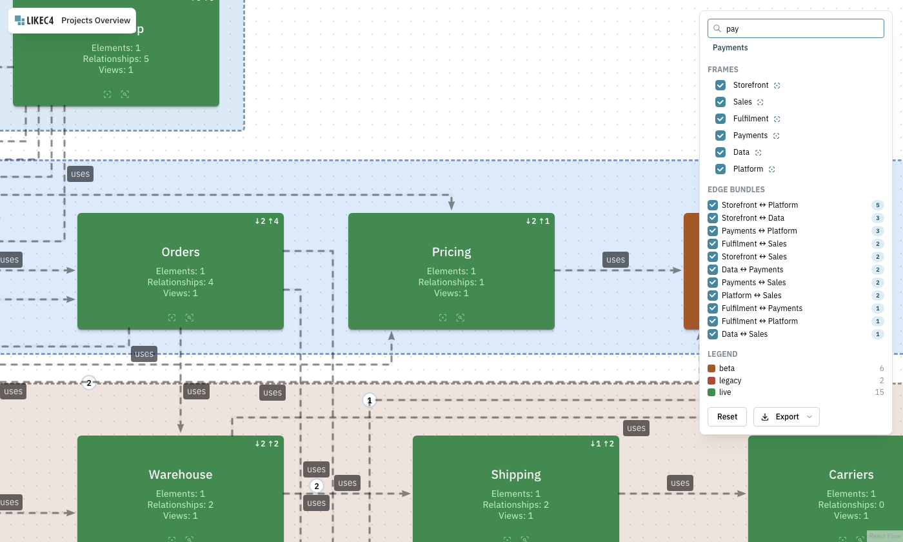

import { Card, FileTree, Aside } from '@astrojs/starlight/components';

Sometimes you may want to split your LikeC4 model into multiple ones, based on domains, teams, or any other criteria.

You can do this by creating multiple projects in your workspace and linking them together.  
You can also use this feature to share your model with other teams or projects.

Create `likec4.config.json` files in the folders you want to be projects:

<FileTree>
- cloud
  - **likec4.config.json**
  - service1.c4
  - service2.c4
  - ...
- externals
  - **likec4.config.json**
  - amazon.c4
  - ...
</FileTree>

LikeC4 finds projects by scanning the workspace (the folder open in the editor, or the path given to the CLI) for [config files](/config/#config-file), skipping folders like `node_modules` and `.git`.  
Each config file defines a project in its folder.  
A source file belongs to the project with the closest folder.  
Files outside of any project folder, and not included by any project, belong to the `default` project.

Projects can be nested.  
In this case, files from the nested project are not part of the parent project.

<FileTree>
- cloud
  - likec4.config.json
  - service1.c4
  - service2.c4
  - nested
    - likec4.config.json
    - service3.c4 // this will be part of the 'nested' project, not the 'cloud' project
</FileTree>


## Import elements

You can import elements from other projects by using the `import` keyword.

```likec4
import { serviceA } from 'projectA'

model {
  serviceB = service {
    -> serviceA.api 'calls serviceA'
  }
}
```

<Aside type='caution' title="Limitations">
At the moment, the following limitations apply:
- Referenced projects must be loaded in the same workspace
- Only top-level **model** elements can be imported
</Aside>

## Share specification

You can share specification files (or any other LikeC4 sources) across multiple projects using the `include` configuration option.

### Using include paths

Add an `include` configuration to your project to include files from directories outside the project folder:

<FileTree>
- shared
  - specs.c4
  - common-styles.c4
- cloud
  - likec4.config.json
  - services.c4
  - ...
- externals
  - likec4.config.json
  - amazon.c4
  - ...
</FileTree>

Both `cloud` and `externals` projects can include the shared specification:

```json title="cloud/likec4.config.json"
{
  "$schema": "https://likec4.dev/schemas/config.json",
  "name": "cloud",
  "include": {
    "paths": ["../shared"]
  }
}
```

```json title="externals/likec4.config.json"
{
  "$schema": "https://likec4.dev/schemas/config.json",
  "name": "externals",
  "include": {
    "paths": ["../shared"]
  }
}
```

Paths are relative to the project folder.  
For `maxDepth`, `fileThreshold` and the rules for paths, see [Include additional directories](/config/#include-additional-directories).

### Using symlinks (alternative)

Alternatively, you can use symlinks to share files:

<FileTree>
- shared
  - specs.c4
- cloud
  - specs.c4 // -> ../shared/specs.c4
  - likec4.config.json
  - ...
- externals
  - specs.c4 // -> ../shared/specs.c4
  - likec4.config.json
  - ...
</FileTree>

<Aside type='note'>
The `include` configuration is generally preferred over symlinks as it's more portable and easier to manage.
</Aside>

## Projects overview

A workspace with more than one project opens on the projects overview: one box per project, and an edge where one project imports from another.

`projectsOverview` in a project config changes that diagram for the whole workspace. Put it on one project. If two projects set different values, LikeC4 reports a warning and uses the project with the shortest folder path.

```json title="landscape/likec4.config.json"
{
  "name": "landscape",
  "projectsOverview": {
    "groupBy": {
      "key": "domain",
      "colors": { "payments": "amber", "shop": "sky" },
      "thenBy": { "key": "team" }
    },
    "colorBy": {
      "key": "sourcing",
      "colors": { "build": "green", "buy": "blue", "retire": "muted" }
    },
    "routing": "ortho",
    "exclude": { "key": "kind", "values": ["metamodel"] }
  }
}
```

```json title="payments-api/likec4.config.json"
{
  "name": "payments-api",
  "metadata": {
    "domain": "payments",
    "team": "checkout",
    "sourcing": "build",
    "kind": "system"
  }
}
```

- `exclude` hides the projects whose metadata `key` has one of the listed `values`, together with their edges. A project without the key is never hidden. Use it for projects that only hold shared definitions or people. It runs first, so a hidden project creates no frame.
- `groupBy` draws a frame for each metadata value. `thenBy` draws a frame inside that frame. `colors` on a level tints the frames of that level by value, with a theme color (same list as `colorBy`). A frame without a mapping stays gray. A project without the key stays in its current parent, on the canvas or inside the outer frame. There is no frame for a missing value.
- `order` stacks the frames of the `groupBy` key from top to bottom, one row each, like layers. Values in the list come first, in list order. Other values follow, alphabetically. `order` needs `groupBy`, and it ranks the first level only. All projects of a frame, also those in an inner frame, share one row. Without `order`, the layout engine places the frames, and their order is not defined.
- `colorBy` colors a project from one metadata value. The color is a theme color (`primary`, `secondary`, `muted`, `amber`, `blue`, `gray`, `slate`, `green`, `indigo`, `red`, `sky`). A value without a mapping keeps `primary`. Frames take their color from `groupBy`, not from `colorBy`.
- `routing` is `spline` (the default) or `ortho` for right-angle edges.

- Metadata values are read as text. A string is trimmed. A number or a boolean becomes text (`1`, `true`). An empty string, an array or an object is ignored.

### Explore the overview

A side panel gives the reader controls to cut a large overview down to what matters. The controls change only the view in the browser. They do not change the config, and they reset when the page reloads.



#### Show and hide frames

Clear the checkbox of a frame to hide it with its projects and the edges that touch them. Tick it again to show it. The other frames keep their position, so the picture does not jump.


To look at one frame alone, use "Show only this frame" on the frame, or the icon next to its name in the panel. The view zooms to that frame. Use "All projects" or press `Escape` to go back.



#### Edge bundles

Edges between two frames follow one shared path. A badge on the path shows how many edges the bundle holds. The panel lists every bundle with its edge count.

- Clear the checkbox of a bundle to hide its edges and its badge. The frames and projects stay.
- Click the name of a bundle, or its badge, to highlight its edges and the projects at both ends. Everything else fades.
- Hover the name to see the project pairs in the bundle.




#### Highlight a project

Each project shows two numbers: the edges that point to it, and the edges that leave it. The numbers count only the edges that are visible, so they follow the hidden frames and bundles.

Use "Highlight connected projects" on a project to fade everything except the project and its direct neighbors. Press `Escape` or click the empty canvas to clear it.



#### Search

Type in the search field to find a project by title. Select a result to zoom to the project and highlight it with its neighbors.



#### Legend

When `colorBy` is set, the panel shows one swatch for each metadata value, with the number of projects. A hidden frame does not change the legend.

#### Export

The "Export" menu offers the same formats as the export menu of other views.


| Format | Result |
| --- | --- |
| `.png`, `.jpg` | The whole overview as an image, cropped to the shown frames. The side panel is not part of it. |
| `.dot`, `.d2`, `.mmd`, `.puml` | The text source of the overview: Graphviz DOT, D2, Mermaid, PlantUML. |
| Draw.io | Opens the overview in diagrams.net. |

Images follow the choices of the reader. Text sources always describe the full overview.

Set [`webapp.exportFormats`](/config/#webapp-export-formats) in a project config to remove formats from the menu. The overview shows a format only when every project enables it. If a project sets `"exportFormats": []`, the overview has no export menu.
