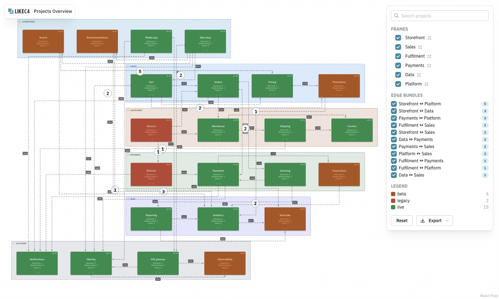
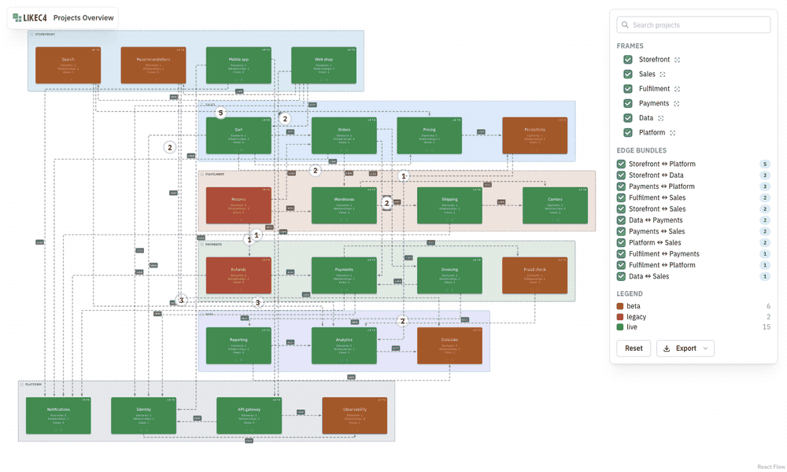

# RFC: Configurable projects overview

| Field          | Value                                                                                  |
| -------------- | -------------------------------------------------------------------------------------- |
| Status         | Draft (draft → proposed → accepted or rejected → implemented)                          |
| Authors        | Endre Deak                                                                             |
| Created        | 2026-11-20                                                                             |
| Discussion     | To be opened in [Ideas](https://github.com/likec4/likec4/discussions/categories/ideas) |
| Implementation | One PR (section 13)                                                                    |
| User docs      | `apps/docs/src/content/docs/config/multi-projects.mdx`                                 |

## 1. Summary

A workspace with more than one project opens on the projects overview: one diagram with a box for each project
and an edge for each pair of projects that have relationships between their elements, through an import. An import
alone does not create an edge. LikeC4 generates this diagram, and nothing configures it.
With many projects the diagram is a flat grid of equal boxes and crossing curves.

This RFC adds an optional `projectsOverview` configuration with these settings:

- `exclude`: hide projects by a metadata value, for example projects that only describe the metamodel.
- `groupBy`: put projects into nested frames by the values of project metadata keys.
- `colorBy`: give each project a theme color from the value of a metadata key.
- `routing`: draw edges with right-angle bends.

The overview also gets reader controls in the browser. They need no configuration:

- show or hide frames and edge bundles, or show only one frame;
- highlight a project with its neighbors, or a bundle, and search projects by title;
- see the incoming and outgoing edge count of each project, and the legend of `colorBy`;
- export the overview in the same formats as every other view: PNG, JPG, DOT, D2, Mermaid, PlantUML and Draw.io.

Without the configuration the overview does not change, apart from these controls.

This RFC asks the community and the maintainers to accept the design and the decisions in section 12.

## 2. Motivation

### Problems

1. **No structure.** Every project is a top-level box on one canvas. The overview does not show domains, teams or
   any other structure that the organization uses.
2. **No visual meaning.** Every project has the color `primary`. The reader cannot see a property of a project
   (build or buy, cloud or on-premises, lifecycle) without opening it.
3. **Edges are hard to follow.** Edges are curves. With many projects they cross the whole canvas
   (screenshot in the discussion). Element views have orthogonal routing since
   [#3278](https://github.com/likec4/likec4/pull/3278), the projects overview does not.
4. **The data exists, but the overview does not use it.** Each project already has `metadata` in its config,
   and the model already carries it (`LikeC4Project.metadata`).

### Goals

- A reader sees the structure of the workspace at the first look: which projects belong together.
- A reader sees one chosen property of each project from its color.
- The configuration uses data the projects already have. No new DSL.
- The overview stays generated: a new project appears in the correct group without a change of the overview config.
- A reader can cut a large overview down to the part that matters, without a change of the config.
- The overview exports to the same formats as other views, and the same `webapp.exportFormats` setting controls them.

### Non-goals

- A hand-drawn overview or saved positions (manual layout) of the overview.
- Changes of what an edge means. Edges stay "a relationship from an element of project A to an element that project A imports from project B".
- Changes of the single-project landing page (the view grid of `landingPage`).

## 3. Proposal

### Describe the projects

Each project describes itself with metadata in its own config. Metadata exists today.

```json title="payments-api/likec4.config.json"
{
  "name": "payments-api",
  "metadata": {
    "domain": "payments",
    "team": "checkout",
    "sourcing": "build"
  }
}
```

### Configure the overview

One config configures the overview for the workspace (decision D1).

```json title="likec4.config.json"
{
  "name": "landscape",
  "projectsOverview": {
    "groupBy": {
      "key": "domain",
      "colors": { "payments": "amber", "shop": "sky" },
      "thenBy": { "key": "team" }
    },
    "colorBy": {
      "key": "sourcing",
      "colors": { "build": "green", "buy": "blue", "retire": "muted" }
    },
    "routing": "ortho",
    "exclude": { "key": "kind", "values": ["metamodel"] }
  }
}
```

### Exclusion rules

- `exclude` has one metadata `key` and a list of `values`.
- A project is hidden when its value for the key (section 4.2) equals one of the listed values.
  A project without a value is never hidden.
- A hidden project has no node and no edge. Edges to and from it are dropped, and the other projects stay.
- Exclusion runs before grouping, ordering and coloring. A hidden project does not create a frame.

### Grouping rules

`groupBy` is a chain. Each level has one metadata `key`. `thenBy` is the next level, with the same shape.

| Project metadata                     | Position in the overview                 |
| ------------------------------------ | ---------------------------------------- |
| `domain: payments`, `team: checkout` | frame `payments` → frame `checkout`      |
| `domain: payments`, no `team`        | frame `payments`, beside the team frames |
| no `domain`, `team: checkout`        | canvas, beside the domain frames         |
| no `domain`, no `team`               | canvas, beside the domain frames         |

- A frame is created for each value that at least one project has. The frame title is the value.
- `colors` on a level maps values to theme colors. The frames of that level take the color as a tint. A frame without a
  mapping stays `gray`.
- A project without a value for the key stays in its current parent (a frame or the canvas).
  There is no "Unspecified" frame.
- `thenBy` applies only to projects inside a frame of the level above.
  A project on the canvas is not grouped by `team`, even if it has a `team`.
- Frames have no edges. Edges stay between projects and cross the frames.
- `order` stacks the frames of the first `groupBy` key from top to bottom, like layers. Listed values come first,
  in list order. Unlisted values follow, alphabetically. `order` applies to the first level only, and it needs
  `groupBy`. All projects of a frame (also those in an inner frame) share one row.
  Without `order`, the layout engine places the frames, and the order is not defined.

### Coloring rules

- A project gets the color that `colors` maps to its value of `key`.
- A project without a value, or with a value that `colors` does not map, keeps the color `primary`.
- Frames do not take a color from `colorBy`. Frame colors come from `colors` of the `groupBy` level.

### Routing

- `routing: "ortho"` draws edges with right-angle bends, the same as `routing ortho` in element views.
- The default is `spline`, the current behavior.

## 4. Detailed design

### 4.1 Configuration schema

In `packages/config/src/schema.ts`, an optional key of the project config:

```ts
const GroupBySchema: z.ZodType<GroupBy> = z.lazy(() =>
  z.strictObject({
    key: z.string().trim().nonempty(),
    colors: z.record(z.string().nonempty(), z.enum(ThemeColors)).optional(),
    thenBy: GroupBySchema.optional(),
  })
)

export const ProjectsOverviewSchema = z.strictObject({
  exclude: z.strictObject({
    key: z.string().trim().nonempty(),
    values: z.array(z.string().trim().nonempty()).min(1),
  }).optional(),
  groupBy: GroupBySchema.optional(),
  order: z.array(z.string().trim().nonempty()).optional(),
  colorBy: z.strictObject({
    key: z.string().trim().nonempty(),
    colors: z.record(z.string().nonempty(), z.enum(ThemeColors)),
  }).optional(),
  routing: z.enum(['spline', 'ortho']).optional(),
})
```

Validation errors:

- an empty `key`, in `groupBy`, `colorBy` or `exclude`;
- an `exclude` without values, or with an empty value;
- the same `key` twice in one `groupBy` chain (it makes frames with one child frame only);
- an `order` without `groupBy`, or a value that appears twice in `order`;
- a color that is not a theme color, in `colorBy` or in `groupBy.colors` (`amber`, `blue`, `gray`, `slate`, `green`, `indigo`, `muted`, `primary`, `red`,
  `secondary`, `sky`). The overview uses the default theme, so custom colors of one project do not apply.

`packages/config/schema.json` is generated again with `pnpm generate`.

### 4.2 Metadata values

`metadata` accepts any JSON value. One function reads the value of a key for grouping and for coloring:

| Metadata value                | Value used          |
| ----------------------------- | ------------------- |
| non-empty string              | the string, trimmed |
| number, boolean               | `String(value)`     |
| empty string, `null`, missing | no value            |
| array, object                 | no value            |

Numbers and booleans are accepted because a flag such as `"cloud": true` is a common use for `colorBy`.

### 4.3 Compute

`computeProjectsView(models, options?)` in `packages/core/src/compute-view/projects-view/compute.ts` gets an optional
second argument with the type `ProjectsOverviewOptions` (defined in core, same shape as the schema).

1. Drop the projects that `exclude` matches. Drop their imports, so no edge reaches them.
   Build the project nodes of the other projects as today. Set `color` from `colorBy`.
2. Group: for each level of `groupBy`, for each parent (the canvas first), split the projects of that parent by value.
   Create one group node for each value. Move the projects with that value into it. Continue with `thenBy` inside
   each new group only.
3. Group node: `kind: '@group'`, `title` = value, `color` = `colors[value]` of the level, or `'gray'`, style of the default group (dashed border,
   opacity 15), `children` = project nodes and child groups. `level` and `depth` are set, because the layouter
   needs `depth` for clusters.
4. Group node id: `stringHash('@group:' + path)`, where `path` is the list of `key=value` pairs from the canvas.
   Project ids use `stringHash(projectId)`, so the ids do not collide.
5. Order: group nodes in ascending order of value, after the values of `order`; projects keep the order of
   `topologicalSort`, which already puts parents before children.
6. Set `routing: 'ortho'` on the view if configured. The view type already has `routing` (`BaseViewProperties`).
7. If `order` is set, set `layers` on the view: the ids of the top-level groups, in the order of step 5.

Edges between the shown projects do not change. Without options, the output is the same as today.
If `exclude` hides every project, the view has no nodes, and `LikeC4LanguageServices.projectsOverview` throws an error
that names `projectsOverview.exclude`.

### 4.4 Owner of the configuration

The language server finds the config that has `projectsOverview` (decision D1) and passes its options to
`computeProjectsView` in `LikeC4LanguageServices.projectsOverview`. This is the only call site.
The Vite plugin (`likec4:projects-overview`), the static build and the VS Code preview all use this method,
so they need no change for data.

### 4.5 Layout

Mostly no change in `packages/layouts`:

- `DotPrinter` already prints compound nodes as Graphviz clusters, as for groups in element views.
- `DotPrinter` already sets `splines=ortho` when `view.routing === 'ortho'`, and `GraphvizParser` already places the
  labels of orthogonal edges.

One addition in `ProjectsViewPrinter`, for `view.layers`:

- The projects of each layer go into one `rank=same` subgraph, so a layer is one row.
- An invisible edge joins the first project of each layer to the first project of the next layer. The edge makes
  the rows follow the order of `layers`.
- `newrank=true` is set (`enableNewRankIfNeeded`), so the rows hold across nested clusters.

Graphviz minimizes edge crossings and ignores the input order of clusters. Without the rows, `order` has no effect on
dense workspaces. Edges between projects still compete for the horizontal position, so a row can sit away from the
column of the other rows.

Tests confirm that `ProjectsViewPrinter` prints clusters, ortho routing and layers correctly (section 8).

### 4.6 Render

In `packages/diagram/src/projects-overview`:

- `_types.ts`: a second node type `project-group`, next to `project`. The name `group` is a built-in XYFlow node type
  with its own CSS (border, padding and background), so it is not used.
- `layouted-to-xyflow.ts`: map `@group` nodes to `project-group` with `ZIndexes.Compound`, and project nodes as today.
- `custom/nodeTypes.tsx`: a `GroupNode` built from the compound components in `base-primitives`.
  A group has no navigate button.
- `custom/edgeTypes.tsx`: draw the edge with `layoutedEdgePath` and the view routing (as element views do),
  not with `bezierPath`. The edge reads its endpoints from the XYFlow store with a deep equality check, so it
  does not render again when only the viewport changes.
- `LikeC4ProjectsOverview.tsx`: turn on reduced graphics (no blend modes, shadows or motion) when the view has more
  than `LARGE_VIEW_AREA` pixels, the same limit as element views. A large overview with full graphics drops frames
  while zooming. In a test with 55 projects, p95 frame time fell from 83 ms to 17 ms.

#### Interactive controls

The reader changes the view in the browser. The controls do not change the config or the layout.



| Control            | Behavior                                                                                                                                                                                         |
| ------------------ | ------------------------------------------------------------------------------------------------------------------------------------------------------------------------------------------------ |
| Hide a frame       | A checkbox per frame hides the frame with its projects and edges. Hidden space stays empty (no re-layout).                                                                                       |
| Show only a frame  | Fits the frame on screen and hides the rest. Nested frames and projects stay visible. "All projects" or `Escape` returns.                                                                        |
| Highlight project  | Highlights the project and its direct neighbors, dims the rest. Clear with `Escape` or a click on the empty canvas.                                                                              |
| Search             | Finds visible projects by title. A pick highlights the project and fits it on screen.                                                                                                            |
| Hub counts         | Each project shows its incoming and outgoing edges, counted among the visible edges. The color is the text color of the box.                                                                     |
| Edge bundles       | Edges between two top-level frames form one bundle with one badge near the middle of its edges. Each edge keeps its own path. The badge shows the edge count. A tooltip lists the project pairs. |
| Hide a bundle      | A checkbox per bundle hides the edges of that bundle only. The projects stay. A hidden bundle stays in the list, so it can be shown again.                                                       |
| Highlight a bundle | A click on the badge or on the name highlights the edges of the bundle and the projects at both ends.                                                                                            |
| Legend             | Lists the colors of `colorBy` with the project count of each value.                                                                                                                              |
| Reset              | Shows every frame and bundle and clears the highlight.                                                                                                                                           |
| Export             | Menu with the formats of section 4.6.1.                                                                                                                                                          |



The state is kept in the overview actor (`packages/diagram/src/projects-overview/actor.ts`). The derived nodes and
edges are computed from the layout by the pure function `deriveOverview` (`derive.ts`). Nothing is saved between
sessions.

The first fit and "Reset" fit the visible nodes (`visibleBoundsOf`), not the bounds that Graphviz reports.
The Graphviz bounds can be much larger than the content, which made the first view too small.

#### 4.6.1 Export

The export menu offers the formats of the "Export" menu of other views. The formats are those of
`webapp.exportFormats`: `png`, `jpg`, `dot`, `d2`, `mmd`, `puml`, `drawio`.

| Format              | Where it is made                                                                                                   | What it contains                               |
| ------------------- | ------------------------------------------------------------------------------------------------------------------ | ---------------------------------------------- |
| `png`, `jpg`        | In the browser (`html-to-image`, loaded on demand), from the XYFlow viewport                                       | The shown frames, cropped. Not the side panel. |
| `dot`               | Language server: `projectsOverviewDot()` prints the computed overview with `ProjectsViewPrinter` and unflattens it | The full overview                              |
| `d2`, `mmd`, `puml` | `generateProjectsOverviewSources` in `@likec4/generators`, with the existing D2, Mermaid and PlantUML generators   | The full overview                              |
| `drawio`            | Same function: the Draw.io generator, then `generateDrawioEditUrl`. The menu opens the URL                         | The full overview                              |

Design:

- `generateProjectsOverviewSources` wraps the layouted overview in a temporary model with one element view, so the
  existing generators run unchanged. Project nodes get the element kind `project`, frames keep the kind `@group`.
- The `likec4:projects-overview` virtual module adds `useLikeC4ProjectsOverviewExports()`. It returns the enabled
  formats and the text sources. A source exists only when its format is enabled. The sources are plain strings, so the
  static build inlines them and the dev server updates them on hot reload.
- The diagram package does not know where the sources come from. `LikeC4ProjectsOverview` takes an optional `exports`
  prop. Without it, the menu offers only `png` and `jpg`, which need no data from the host.
- A format is enabled only when every project enables it (D15). The overview shows the data of all projects, so one
  project can switch a format off for it.
- Images follow the choices of the reader (hidden frames are not drawn). Text sources always describe the full
  overview (D16), because they are made before the page loads.

### 4.7 Architecture fit

| Package              | Role in this design                                                                     |
| -------------------- | --------------------------------------------------------------------------------------- |
| `config`             | `projectsOverview` schema and validation                                                |
| `core`               | `ProjectsOverviewOptions` type; grouping, coloring and routing in `computeProjectsView` |
| `language-server`    | Find the owner config, pass the options, report a conflict (D1)                         |
| `diagram`            | `group` node type, routed edge path, reader controls, image export, `exports` prop      |
| `layouts`            | `ProjectsViewPrinter` stacks `view.layers` as ranks; `dotProjectsView` prints DOT       |
| `generators`         | `generateProjectsOverviewSources`: D2, Mermaid, PlantUML, Draw.io URL                   |
| `vite-plugin`        | `useLikeC4ProjectsOverviewExports` in `likec4:projects-overview`; format filter         |
| `likec4-spa`         | The overview page passes the exports to the diagram                                     |
| `vscode-preview`     | Not changed (image export only, no `exports` prop)                                      |
| `core/manual-layout` | Not changed: the projects overview is not saved as a manual layout                      |

### 4.8 Public surface

| Area   | Addition                                                                                                                                       |
| ------ | ---------------------------------------------------------------------------------------------------------------------------------------------- |
| Config | `projectsOverview.groupBy`, `.order`, `.colorBy`, `.routing`, `.exclude`                                                                       |
| Core   | `ProjectsOverviewOptions`; optional second argument of `computeProjectsView`                                                                   |
| Model  | `LayoutedProjectsView` can contain `@group` nodes, `routing` and `legend`; `ComputedProjectsView.layers`                                       |
| Export | `generateProjectsOverviewSources` (`@likec4/generators`); `LikeC4LanguageServices.projectsOverviewDot()`; `GraphvizLayouter.dotProjectsView()` |
| Module | `likec4:projects-overview` exports `useLikeC4ProjectsOverviewExports()` and the type `ProjectsOverviewExports`                                 |
| UI     | `LikeC4ProjectsOverview` accepts an optional `exports` prop (`ProjectsOverviewExports`)                                                        |

All additions are optional. No existing API changes.

## 5. Compatibility

- Workspaces without `projectsOverview`: the overview is the same as today. Existing snapshots do not change.
- `metadata` already exists. Projects need no change to keep working.
- Consumers of `LayoutedProjectsView` that expect only project nodes must skip `@group` nodes.
  Inside the repository the only consumer is the projects-overview renderer (section 4.6).
- Projects loaded from outside the workspace by the proposed project dependencies
  ([#3571](https://github.com/likec4/likec4/pull/3571)) are grouped by the same rules if they appear in the overview.
  This RFC does not change which projects appear.
- No new dependencies.

## 6. Security and privacy

- Frame titles show metadata values. A static build publishes them on the overview page.
  Do not put confidential values in metadata keys used by `groupBy`.
- Metadata values are rendered as text. No markup, no code execution, no network access.
- Text exports and the Draw.io URL contain the titles of all projects. A project that must stay private can switch
  the formats off with `webapp.exportFormats`. The overview then offers only the formats that every project enables.
- The Draw.io URL carries the diagram in the URL fragment, as the export of other views does.

## 7. Performance

- Grouping and coloring are linear in the number of projects times the number of `groupBy` levels.
- Graphviz needs more time for clusters and for `splines=ortho`. Workspaces have tens of projects, not thousands,
  so the effect is small. The layout runs once per model change, as today.
- `deriveOverview` is linear in the number of nodes and edges. It runs on each control change, not on viewport change.
- `html-to-image` loads on the first image export. The text sources are generated only for the enabled formats.
- Image export scales the pixel ratio down so that the longest side stays below 8000 pixels.

## 8. Testing and validation

- `config`: valid chains of one, two and three levels; empty key; same key twice in a chain; unknown color;
  unknown property; no `projectsOverview`; `exclude` with key and values, without values, with an empty key.
- `core` (`compute.spec.ts`):
  - one level, nested levels;
  - a project without a value stays in its parent, on the canvas and inside a frame;
  - `thenBy` does not group projects on the canvas;
  - value rules of section 4.2 (string, trimmed string, number, boolean, empty, array, object);
  - `colorBy`: mapped value, unmapped value, no value;
  - frame colors by level, unmapped frames stay gray;
  - `routing: 'ortho'` sets the view routing;
  - no options gives the same view as today;
  - group ids are stable when the order of projects changes;
  - `order`: listed values first, unlisted values after in alphabetical order, first level only;
  - `layers` is set only when `order` is set;
  - `exclude`: hidden project and its edges, project without the key stays, every project hidden gives no nodes.
- `layouts`: DOT snapshots of a projects view with nested clusters and ortho routing, and with layers (one `rank=same`
  subgraph per layer, invisible edges between layers, `newrank`); no layers without `order`; layout test that every
  edge is axis-aligned (`isOrthoSpline`), as for element views.
- `language-server`: one owner, two owners with different configs (warning, D1), no owner.
- `diagram`: `layoutedProjectsViewToXYFlow` maps group nodes and project nodes; `deriveOverview` hides frames and
  their edges, hides the edges of a hidden bundle, focuses one frame, highlights a project or a bundle, counts visible edges per project and groups
  cross-frame edges into bundles; `absoluteBoundsOf` sums parent positions; `visibleBoundsOf` skips hidden nodes.
- `generators`: D2, Mermaid, PlantUML and the Draw.io URL of a layouted overview with a frame, projects and an edge.
- `vite-plugin`: `overviewExportFormats` for no restriction, one restricting project, one project with no export,
  and no projects.
- Manual checks in a browser: every menu item downloads or opens; the PNG and JPG show the whole overview without
  the panel; hidden frames are missing in the image.
- Manual checks: `likec4 start` with hot reload after a change of metadata or of the overview config;
  `likec4 build`; the VS Code preview.

## 9. Drawbacks

- Under D1, option A, a project config holds a setting for the whole workspace.
- Groups come only from config metadata, not from the DSL.
- Only the 11 default theme colors are available.
- A frame with one project takes more space than the project alone.
- Orthogonal edges between frames can take long detours around the frames.
- With `order`, the projects of a frame share one row. Edges inside a frame no longer run top to bottom.
- Layers order the frames. They do not reduce the number of edges. A workspace where most projects depend on a few
  hub projects still draws many long edges.

## 10. Alternatives considered

| Alternative                                                                                                 | Why not                                                                                                                                                             |
| ----------------------------------------------------------------------------------------------------------- | ------------------------------------------------------------------------------------------------------------------------------------------------------------------- |
| A hand-made overview project that imports the top-level elements of each project and draws a landscape view | Works today, but the imports are elements, not projects; every new project needs a manual change; the multi-project landing page still shows the generated overview |
| Group by folder path, without config                                                                        | Folders often do not match domains or teams; can be added later as a `groupBy` source                                                                               |
| Tags on projects                                                                                            | Projects have no tags; metadata already exists and has values, not only names                                                                                       |
| Manual layout of the overview (drag and save)                                                               | Does not follow when projects are added; positions go stale                                                                                                         |
| A grid of project cards instead of a diagram                                                                | Loses the relations between projects; can be a later option                                                                                                         |
| An "Unspecified" frame for projects without a value                                                         | Adds a frame that has no meaning in the organization; projects without a value are easier to see outside the frames                                                 |

## 11. Prior art

- **Structurizr** system landscape views: elements have a `group` property, and the `structurizr.groupSeparator`
  property makes nested groups from one value (`Payments/Checkout`). This RFC uses one key for each level instead,
  so each level comes from data that already exists.
- **Backstage** software catalog: components belong to systems, and systems belong to domains.
  This is the same two-level structure as `groupBy: domain, thenBy: team or system`.

## 12. Decisions requested

The community and the maintainers are asked to accept or change each decision. The recommendation is in bold.

D1 is the main open question. The overview spans all projects, but each config file belongs to one project.
The options:

- **A**: the `projectsOverview` key in any project config. If two configs set it with different values, the language
  server reports a warning, and the project with the shortest folder path (then by name) wins.
  No new file, no new discovery. A project config holds a setting for the whole workspace.
- **B**: a new workspace file (for example `likec4.workspace.json`) at the workspace root. Clear ownership.
  Needs a new file name, discovery, schema and file watcher.
- **C**: tool options (CLI flag, Vite plugin option, VS Code setting). No config change. Three places to keep equal,
  and the static site and the editor can show different overviews.

| #   | Decision                                                                                                                              | Recommendation                                            |
| --- | ------------------------------------------------------------------------------------------------------------------------------------- | --------------------------------------------------------- |
| D1  | Owner of the overview configuration: option A, B or C                                                                                 | **A**; change to B if more workspace settings are planned |
| D2  | `groupBy` is a chain `{ key, thenBy? }`. Keys in one chain are unique                                                                 | **Accept**                                                |
| D3  | A project without a value stays in its parent. No "Unspecified" frame. `thenBy` applies only inside frames                            | **Accept**                                                |
| D4  | Values: trimmed strings, numbers and booleans (`String(value)`); other values count as no value                                       | **Accept**                                                |
| D5  | `colorBy` maps values to default theme colors; unmapped values keep `primary`; frames do not take `colorBy`                           | **Accept**                                                |
| D6  | `routing` option for the overview, default `spline`. Project defaults (`styles.defaults.view.routing`) do not apply to the overview   | **Accept**                                                |
| D7  | Delivery in one PR with a linked issue (section 13)                                                                                   | **Accept**                                                |
| D8  | `order` stacks the frames of the first `groupBy` key from top to bottom, one row each. Unlisted values follow, alphabetically         | **Accept**                                                |
| D9  | `exclude` hides projects by one metadata key and a list of values. Their edges are dropped. A project without a value is never hidden | **Accept**                                                |
| D10 | `groupBy.colors` tints the frames of one level by value. Unmapped frames stay gray. Frames do not take `colorBy`                      | **Accept**                                                |
| D11 | Reader controls (frames, focus, search, highlight, bundles, legend) live in the browser only. They are not saved in the config        | **Accept**                                                |
| D12 | Hidden frames keep their place in the layout. The overview is not re-laid out when a frame is hidden                                  | **Accept**                                                |
| D13 | Edge bundles group the edges between two top-level frames. Nested frames do not make their own bundle                                 | **Accept**                                                |
| D14 | The overview exports to the same formats as other views (`png`, `jpg`, `dot`, `d2`, `mmd`, `puml`, `drawio`)                          | **Accept**                                                |
| D15 | A format is offered only when every project enables it in `webapp.exportFormats`                                                      | **Accept**                                                |
| D16 | Images follow the reader's choices. Text sources always describe the full overview                                                    | **Accept**                                                |

Out of scope, possible later work:

- `direction` and spacing of the overview layout;
- group by folder path;
- manual move of frames (saved positions);
- collapse and expand of frames in place (show only one frame is done, see 4.6);
- filters beyond one key and a list of values (several rules, keep lists, patterns);
- other edge content: one edge per relationship kind, or labels when several relationships connect two projects.

## 13. Rollout

The configuration is opt-in: it has an effect only when a config has `projectsOverview`. The reader controls and the
export menu are always on. No feature flag is needed.

One PR with docs and a `patch` changeset, linked to an issue that describes the features. Reviewers can ask to split
it. The natural split is:

1. **Groups and colors**: config schema, value rules, `computeProjectsView` options, owner resolution in the language
   server, `group` node type in the diagram, `routing`, docs.
2. **Reader controls and export**: `deriveOverview`, the side panel, image export, text exports, docs and images.

## 14. Approval

Review in the discussion or in the PR that adds this RFC.

| Reviewer | Role | Decision (accept, accept with changes, reject) | Decisions changed | Date |
| -------- | ---- | ---------------------------------------------- | ----------------- | ---- |
|          |      |                                                |                   |      |
|          |      |                                                |                   |      |

Outcome: to be filled in after the review (status, accepted decisions, follow-up actions).
